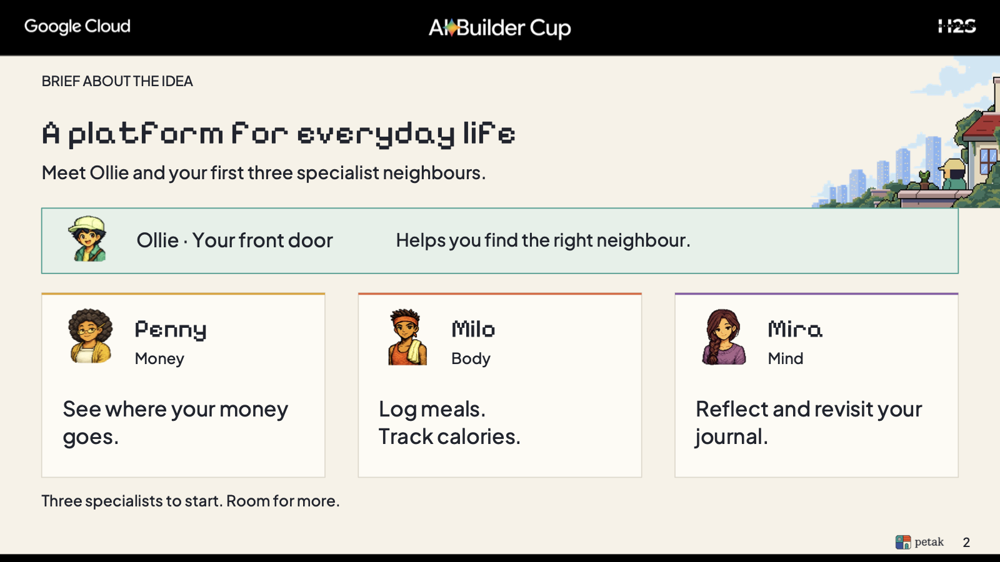

# Petak · Google Cloud AI Builder Cup 2026

Petak is a mobile companion for turning everyday messages and photos into useful conversations and organized records. Instead of moving between separate tools to capture and interpret personal information, people can send it through one app and see the resulting conversation, progress, and dashboards.

This is Petak's public submission repository for the **Google Cloud AI Builder Cup 2026**. It contains a real Expo / React Native mobile client, the small workspace packages it needs, and client-visible API contracts. Petak is an existing product; its API service, execution service, AI workflows, prompts, database, and deployment configuration remain private.



The [selected Builder Cup slides](docs/visuals/README.md) introduce Petak's specialists, features, product flow, and [slide 7 architecture diagram](docs/visuals/builder-cup-slide-7.png). The architecture documentation below explains the integration boundaries.

## How the product works

The mobile app authenticates with Supabase and reaches the private Petak API on Cloud Run through a Cloudflare API proxy. The API owns client requests and durable records in Supabase/PostgreSQL; a separate Cloud Run TypeScript execution worker performs AI work with Vercel AI SDK and provider adapters. Some bounded adapters call model endpoints directly. Approved Gemini requests use Vertex AI as a model endpoint. Photo bytes upload directly to R2 using an API-issued temporary URL. The API returns results through reads and a server-sent event stream. The app **does not call model providers directly**. This describes the restricted QA architecture in the presentation; production rollout is not established. See the [architecture](docs/architecture.md) and [Google Cloud integration](docs/google-cloud.md) for the component and request flows.

**Vercel AI SDK and provider adapters run inside the worker; Vertex AI serves approved Gemini requests.** Petak does not use Google ADK or Google Managed Agent Runtime in this architecture. The backend implementation remains private.

## Repository contents

| Path | Purpose |
|---|---|
| [`apps/app`](apps/app/README.md) | Expo / React Native client, API adapter, UI, and tests |
| `packages/assets`, `packages/config`, `packages/design-system` | Selected app assets, narrow client contracts, and design tokens |
| [`docs`](docs/architecture.md) | Architecture, Google Cloud role, client API contract, and private boundary |

The public repository is buildable as a client workspace. It does not contain the private backend or a replacement for the app's `/v1` API. End-to-end use requires an authorized Petak backend and test account.

## Build the mobile app

Use Node **22.20.0** and pnpm **11.22.0** from the repository root:

```sh
pnpm install --frozen-lockfile
pnpm typecheck
pnpm test
pnpm export
```

`pnpm export` validates the Expo iOS and Android bundles without backend credentials. For interactive use, set the public client variables listed in [`.env.example`](.env.example) and run `pnpm --filter @petak/app dev`. The checked-in values and app identifiers are placeholders; a working end-to-end build must point to an authorized Petak API and Supabase project. Never place a server credential in an `EXPO_PUBLIC_*` variable.

## Evaluate the submission

The editable slide manual, QA build link, and reviewer credentials are supplied separately to judges. The public [architecture](docs/architecture.md) and [client API contract](docs/api-contract.md) explain the source available here.

## Read more

- [System architecture](docs/architecture.md) · [Google Cloud integration](docs/google-cloud.md) · [Client API contract](docs/api-contract.md)
- [Private backend components](docs/proprietary-components.md) · [Selected Builder Cup slides](docs/visuals/README.md)
- [Licensing overview](LICENSE) · [Mobile and supporting source terms](apps/app/LICENSE) · [Brand asset notice](packages/assets/README-LICENSE.md) · [Third-party notices](THIRD_PARTY_NOTICES.md)

This repository is public for evaluation, but **public does not mean fully open source**. The app and supporting Petak source are under limited evaluation terms; Petak brand assets remain proprietary. Third-party materials retain their original licenses. Asset publication rights and delivery of the private judge access instructions require final confirmation before submission.
