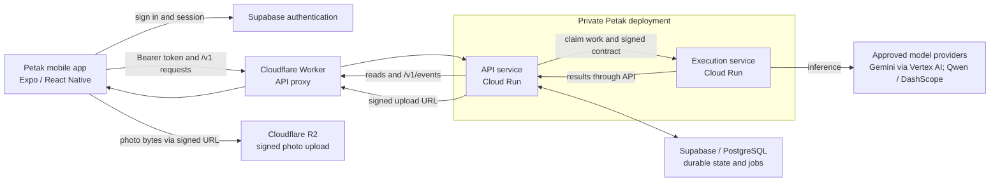
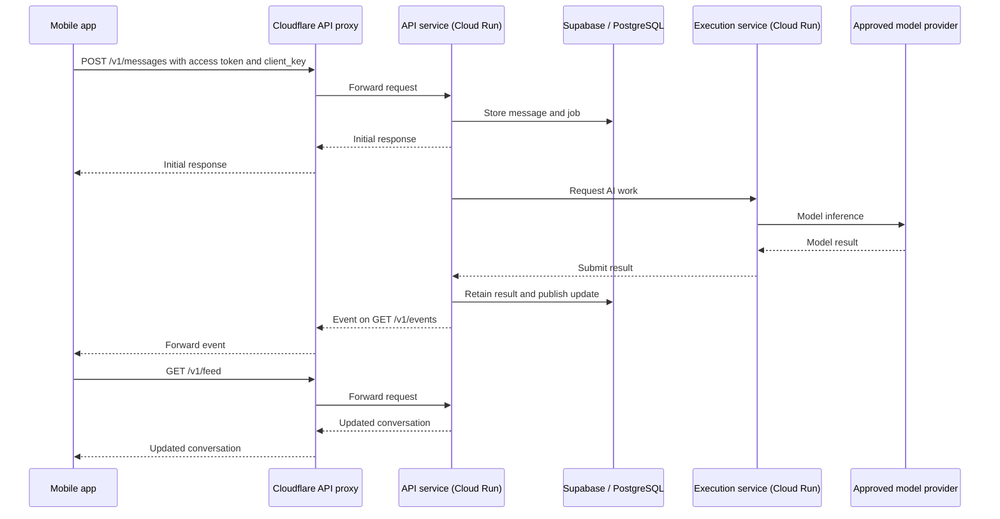
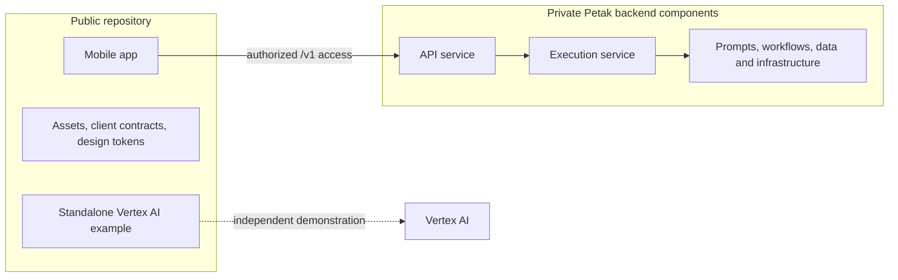

# Petak architecture

Petak's mobile app turns messages and photos into conversations and organized records. The client is public in this repository. The deployed Petak API and AI execution services are private. This document explains the integration boundaries shown on [slide 7](visuals/builder-cup-slide-7.png), not a deployable backend. Slide 7 marks some components as planned; slide 8 places the current deployment in restricted QA and labels production as future.

## Components and ownership

| Component | Responsibility | In this repository? |
|---|---|---|
| Mobile app (Expo / React Native) | Sign-in UI, message and photo capture, local pending work, conversation, progress, and dashboards | Yes: [`apps/app`](../apps/app/README.md) |
| Supabase authentication | User session and access token used by the client | External service; client integration only |
| Cloudflare Worker / API proxy | HTTPS ingress to the private API | No |
| Petak API service (Cloud Run) | Authenticated `/v1` interface, client reads and writes, and event delivery | No |
| Supabase / PostgreSQL | Durable records, jobs, results, and access rules; the API controls application state | External service; schema and server integration private |
| Cloudflare R2 | Photo bytes uploaded from the app through API-issued signed URLs | External service; client upload integration only |
| Petak execution service (Cloud Run) | AI work claimed through the API, using Vercel AI SDK and provider adapters; returns results through the API | No |
| Model providers: Gemini and Qwen / DashScope | Inference called by the execution service; Gemini can be called through Vertex AI | External services; no direct app call |
| Standalone Vertex AI example | Minimal, independent Cloud Run-to-Vertex request | Yes: [`examples/vertex-ai-demo`](../examples/vertex-ai-demo/README.md) |

## Authentication and API boundary

The app signs in through Supabase. Its API adapter retrieves the current session access token and sends it as `Authorization: Bearer` to the Petak API origin configured by `EXPO_PUBLIC_API_URL`. In the slide 7 deployment, a Cloudflare Worker proxies those requests to the Cloud Run API. The API owns the client contract and verifies identity. The public code shows request and response shapes; it does not define server authorization rules or expose the private implementation. See the [client API contract](api-contract.md).

## AI request and result flow

Text and photo actions reach the API through the proxy. The API stores durable records and coordinates jobs in Supabase/PostgreSQL. Work that needs AI processing is handled asynchronously by the private execution service, which uses Vercel AI SDK and provider adapters. The visible technology stack on slide 9 names Gemini and Qwen / DashScope; the private model policy determines which approved provider handles a task. The worker returns results through the API; it does not own the database. The app can receive an initial response before later AI results are available. It keeps the conversation current through `/v1/events` server-sent events and subsequent API reads. Events notify the app to refresh relevant data; they are not the sole source of record.

For a photo, the client first creates a photo record, uploads bytes directly to Cloudflare R2 using a signed URL provided by the API, sends the related message, and calls the photo acceptance endpoint. It can then observe the public capture progress states and refreshed conversation. The diagram shows system responsibilities; scheduling, schemas, and provider policy remain private.

Slide 7 also shows versioned neighbour manifests for personas, skills, approved tools, policies, limits, and pinned versions, plus PostHog for observability. It marks the operator UI, additional scoped tools, and future neighbours as planned. Slide 8 adds automated checks and a human release gate; it does not establish a production rollout.

## Public repository boundary

The example is **representative of one Google Cloud integration pattern**. It is not connected to the mobile app and does not implement Petak's private orchestration. An authorized deployed backend is required for end-to-end product evaluation. See [private backend components](proprietary-components.md) and the [product demo walkthrough](demo-flow.md).
